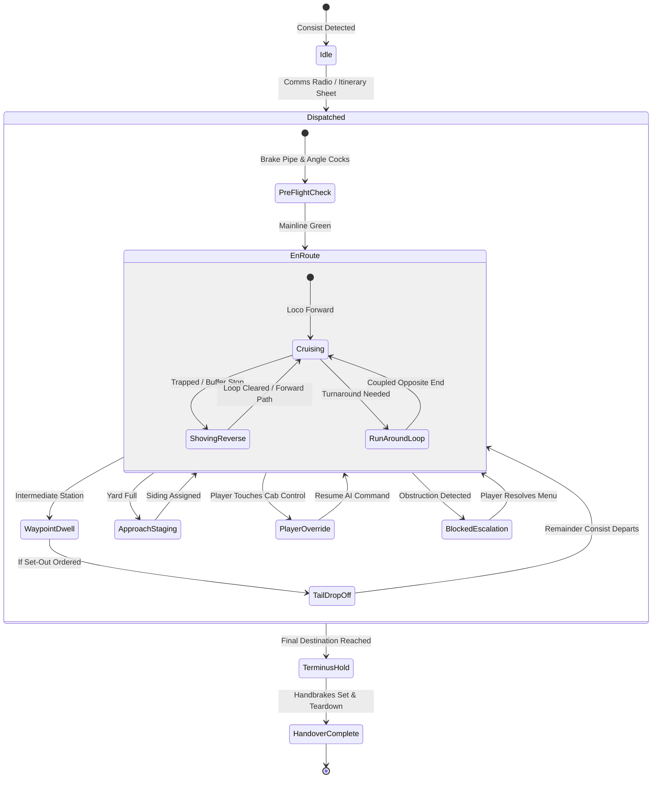

# DV AI Traffic — Phase 2 Design Specification: Player-Employed AI Worker System

> **DOCUMENT TYPE:** High-Level Architectural Reference & Design Blueprint  
> **SCOPE:** Player-Employed AI Worker System (Phase 2)  
> **TARGET MOD:** `dv_ai_traffic`  
> **INTENDED AUDIENCE:** Mod Designers, System Architects, Subagents & Contributors  
> **AUTHORITY:** Aligned with Maximilian Domann's design vision via iterative grill-down.

---

## 1. Executive Summary & Core Philosophy

The primary objective of **Phase 2** is to expand the player-employed AI worker from a basic single-leg station-to-station delivery service into a **complete, diegetic, mainline haulage operations system**. 

The player can employ AI engineers to execute realistic multi-stop freight and passenger delivery contracts, perform locomotive run-arounds, set out cuts of cars at intermediate industry spurs, communicate across the valley via two-way Comms Radio channels, and share cab operations seamlessly as an active co-pilot.

### Core Architectural Pillars
1. **Physical Grounding Over Arcade Shortcuts:**  
   AI workers operate strictly within physical simulation bounds. They do not teleport cars, vanish equipment, ignore pneumatic brake propagation, or magically reconfigure consists. Every uncoupling, switchback, and brake application is physically enacted in the world.
2. **Career Ledger Integrity:**  
   AI workers interact cleanly with the career economy: wages are transparent and predictable, equipment is guarded against mechanical destruction while under AI authority, and locomotive resource consumption follows realistic player-comparable rates without punitive penalties for AI throttle hunting.
3. **Player Agency & Primacy:**  
   The player is always in command. If the player steps into the cab and touches a control, the AI yields immediately. If an obstruction occurs miles away, the worker contacts the player with clear operational choices rather than guessing, getting deadlocked, or despawning.
4. **Clean Phase Boundary:**  
   Phase 2 focuses exclusively on **Mainline Haul Logistics & Set-Outs**. Full automated yard sorting, classification switching, and industrial spot orders are strictly segregated into **Phase 4** (where `dv_ai_traffic` will natively control and execute all AI shunting tasks, maintaining compatibility with mods like `dv_self_shunter` that provide distinct job functionality and persistent rolling stock).

---

## 2. High-Level Goals & System Specifications

```
                       +---------------------------------------+
                       |       Station Dispatch Desk /         |
                       |       Comms Radio Dispatch            |
                       +-------------------+-------------------+
                                           |
                                           v
                       +---------------------------------------+
                       |        Multi-Stop Itinerary           |
                       |       (Leg 1 -> Leg 2 -> Terminus)    |
                       +-------------------+-------------------+
                                           |
         +---------------------------------+---------------------------------+
         |                                 |                                 |
         v                                 v                                 v
+------------------+             +--------------------+            +-------------------+
|  Leg Execution   |             | Run-Around / Shove |            | Intermediate Dwell|
|  (Line Speed /   |             | (Topology Flip     |            | & Tail Drop-Off   |
|   Signals / MU)  |             |  at Loop / Spur)   |            | (Wagons Set Out)  |
+--------+---------+             +---------+----------+            +---------+---------+
         |                                 |                                 |
         +---------------------------------+---------------------------------+
                                           |
                                           v
                       +---------------------------------------+
                       |      Terminus Yard Arrival /          |
                       |      Congestion Staging Hold          |
                       +-------------------+-------------------+
                                           |
                                           v
                       +---------------------------------------+
                       |     Final Handover & Teardown         |
                       |   (Handbrakes Set, Manual Control)    |
                       +---------------------------------------+
```

---

### Goal 1: Multi-Stop Itineraries & Waypoint Routing
* **Concept:** Elevate `AtoBHaulTask` into a full itinerary-based model (`List<ItineraryLeg> Legs`, `CurrentLegIndex`) capable of managing a sequence of ordered stops (e.g., *Origin Station $\to$ Waypoint Station 1 $\to$ Waypoint Station 2 $\to$ Destination Yard*), where a standard A-to-B haul is simply a 1-leg itinerary.
* **Routing Capabilities:**
  * Support intermediate regulatory dwells (scheduled waiting periods for timetable sync or simulated crew rests) where the prime mover remains running and `AIEngineer` transitions seamlessly to the next leg upon dwell expiration (`HaulTaskStatus.WaitingAtIntermediate`).
  * **Deferred Infinite Hold / Radio Resume Mode (Later Package — Goal 4 Integration):** Support an optional infinite intermediate wait mode (`DwellSeconds < 0` / manual hold) where the worker shuts down the prime mover upon intermediate arrival and holds indefinitely until the player issues a *"Resume Run / Proceed"* directive via the Valley-Wide Comms Radio Active Worker Channel (to be implemented alongside the Comms Radio Active Worker Channel & Resume package).
  * Enforce strict forward route pathfinding along each leg, avoiding intermediate occupied mainline blocks.
  * Dynamically recalculate path segments as stops are achieved.

---

### Goal 2: Intermediate Tail-Cut Wagon Drop-Offs (Set-Outs)
* **Concept:** Workers can drop off specified trailing cuts of cars at intermediate station sidings before proceeding with the remainder of the consist.
* **Operational Flow:**
  1. Train pulls completely onto the designated intermediate drop track.
  2. Train halts to a complete stop and holds brakes.
  3. Worker closes pneumatic angle cocks between the lead cut and the trailing set-out cut.
  4. Worker applies mechanical handbrakes across the set-out wagons to secure them against runaway rolls.
  5. Knuckle coupler is released, leaving the set-out cars safely parked on the siding.
  6. Worker releases train air brakes on the remaining forward consist, verifies line clearance ahead, and departs toward the next itinerary waypoint.
* **Scope Boundary:** Phase 2 supports set-outs from the *rear* of the train. Picking up new cuts of cars or complex in-train car reordering is reserved for Phase 4.

---

### Goal 3: Diegetic Station Paperwork (Itinerary Sheets)
* **Concept:** A tangible, physical way to organize and authorize multi-stop operations without breaking game immersion.
* **Manifestation & Workflow:**
  * **Station Dispatch Desk Generation:** At station offices (using existing job booklet desks, racks, or validation stations), players can configure an **Itinerary Sheet**.
  * **Physical Item:** The generated sheet spawns as an in-game physical booklet/folder item detailing the assigned locomotive, consist manifest, ordered stop sequence, drop-off tracks, and hiring costs.
  * **Authorization & Activation:**
    * *Tactile Method:* Player physically carries the folder to the locomotive cab and places it onto the cab clipboard or dash shelf.
    * *Radio Method:* Once generated, the player can point the Comms Radio at the assigned locomotive and pull the trigger to activate the validated itinerary sheet directly.

---

### Goal 4: Valley-Wide Comms Radio Active Worker Channel
* **Concept:** True long-distance two-way communication between the player and their employed train crews across the valley.
* **Radio Architecture:**
  * **Active Workers Channel View:** The Comms Radio `AI WORKER` mode features an interactive channel view listing all currently active worker trains on the island.
  * **Remote Monitoring:** Player can scroll through active consists, inspecting live telemetry (speed, current track, distance to next stop, current aspect, and operational state) from anywhere on the map without requiring line-of-sight laser targeting.
  * **Two-Tier Targeting:**
    * *Local Laser:* Point-and-shoot laser targeting remains active for quick inspection and dispatch when standing near the train ($\le 500\text{m}$).
    * *Remote Radio Tuning:* When an alert notification sounds or a train requires guidance, switching to the Active Workers channel immediately tunes into that specific train's orders.
  * **In-Flight Directives:** Player can transmit mid-transit orders remotely:
    * *Hold at Next Passing Loop*
    * *Resume Run / Proceed*
    * *Emergency Stop (Full Service Brake Application)*
    * *Reroute / Change Destination Track*
    * *Abort & Release to Manual Control*

---

### Goal 5: Locomotive Run-Around & Reverse Shoving Switchback Protocol
* **Concept:** Provide autonomous directional turnaround capability so trains never become stranded at dead-end spurs, buffer stops, or terminal stations.
* **Decision Hierarchy:**
  1. **Primary Choice — Run-Around via Passing Loop:**
     * If an adjacent parallel siding/passing loop is clear and accessible, the AI chooses a locomotive run-around.
     * *Execution:* Consist handbrakes are secured $\to$ locomotive uncouples $\to$ moves forward past the throat turnout $\to$ enters the adjacent clear track $\to$ runs light past the rear of the train $\to$ switches back onto the consist track $\to$ couples onto the opposite end $\to$ connects air hoses $\to$ recharges train brake pipe $\to$ releases handbrakes.
  2. **Fallback Choice — Slow Shunting Reverse Shove:**
     * If the locomotive is trapped directly against a buffer stop (with wagons behind it) or if no clear parallel loop exists, the train cannot uncouple.
     * *Execution:* The train shoves the consist in reverse under **Slow Shunting Mode ($\le 15\text{ km/h}$)**.
     * The reverse movement continues until the consist reaches a trailing turnout or siding where either a forward route opens up or a run-around loop becomes accessible.
     * Once the locomotive is pulling forward again and crosses a clear governing main signal, it transitions back to full line speed.

---

### Goal 6: Destination & Approach Congestion Staging
* **Concept:** Prevent terminal yard gridlocks when the destination receiving tracks are full upon arrival.
* **Staging Behavior:**
  * As the worker approaches the destination station ($\approx 1500\text{m} - 2000\text{m}$), it audits all eligible receiving sidings.
  * If all candidate tracks are occupied by rolling stock or locked by other operations, the train **halts and holds at the station approach outer passing loop or entry signal**.
  * The train secures itself, turns on holding lights, and transmits an **Audible Radio Alert Ping** and HUD toast to the player: *"[Worker Train ID] Holding at [Station] Approach — All receiving tracks occupied. Awaiting orders."*
  * The player can respond via Comms Radio to select an alternative siding, order the train to wait, or intervene manually.

---

### Goal 7: In-Cab Copilot / Assistant Handover
* **Concept:** Seamless co-pilot experience when the player rides inside an active AI worker locomotive cab.
* **Control Handover Mechanics:**
  * **Touch-to-Yield (Immediate Soft Override):** The moment the player touches or manipulates any cab control (throttle lever, independent brake, train brake valve, or reverser), the AI engineer instantly releases its servos and yields vehicle authority to the player.
  * **Cab Status Display:** The radio/HUD status updates to: *"Player in Control — AI Copilot Standing By"*.
  * **Safety Monitoring:** While the player is driving, the AI maintains route awareness, speed limit tracking, and signal observation.
  * **Resumption:** Autonomous driving does not resume abruptly by itself. The player re-engages AI control explicitly by pressing a cab toggle switch (or selecting *"Resume AI Driving"* on the Comms Radio). The AI smoothly blends throttle and braking back to target profile.

---

### Goal 8: Physical Resource Consumption with Stall Capping
* **Concept:** True economic immersion without unfair penalties from AI limitations.
* **Resource Physics:**
  * **Vanilla 1.0x Physical Burn:** Locomotives physically consume diesel fuel, boiler water/coal, lubricating oil, and sand directly from their onboard reservoirs at standard vanilla rates during normal cruising.
  * **Anti-Hunting / Stall Capping:** During low-speed hill-start recovery, traction wheel slip, or grade stagnation, the artificial simulation capping clamps resource consumption spikes to nominal baseline levels. Sub-optimal AI throttle modulation will not drain player tanks or waste sand in seconds.
  * **Damage Immunity Retention:** Full mechanical protection via `AIDamageImmunityPatches` remains strictly active during autonomous transit (preventing catastrophic traction motor burnouts, blown fuses, or cylinder cracks due to AI handling).

---

### Goal 9: Blocked-Track Escalation & Resolution Menu
* **Concept:** When an unexpected obstacle or traffic conflict blocks an AI worker, empower the player with diegetic dispatch choices.
* **Resolution Workflow:**
  * When halted by an obstruction (e.g. stalled ambient train, unaligned switch, or player cars on path) for $> 30\text{s}$, the worker hails the player via the Comms Radio.
  * The Comms Radio interface opens a **Blocked Train Resolution Menu** presenting validated options:
    1. **Wait for Track to Clear:** AI remains parked, holding brakes and monitoring line clearance.
    2. **Reroute via Clear Bypass:** AI calculates an alternative route across clear tracks to circumvent the obstruction.
    3. **Backup into Trailing Siding:** AI initiates a reverse shunting maneuver into the nearest clear siding behind it to clear the mainline.
    4. **Hand Over Control:** Teardown AI authority immediately, leaving the train secured for manual player operation.

---

### Goal 10: Upfront Multi-Leg Wage Billing with Pro-Rated Refunds
* **Concept:** Transparent, fair, and reliable financial mechanics for complex haulage contracts (`[WRK-07]`).
* **Accounting Model:**
  * **Upfront Total Deduction:** Upon dispatch, the total hiring fee for all legs of the itinerary is calculated (`DriverBaseFee` charged once on Leg 0 plus per-leg distance and tonnage fees across all legs, each rounded to `$10`) and deducted upfront from `Inventory.Instance.RemoveMoney(totalFee)`.
  * **10s / 25m Grace Period & Pro-Rated Cancellation Refunds (`CalculateCancellationRefund`):**
    * **Grace Period:** If cancelled within $\le 10.0\text{s}$ of dispatch AND before the lead locomotive has moved $25.0\text{m}$ on Leg 0, **100% of `TotalHiringFee`** (including `DriverBaseFee`) is refunded.
    * **Mid-Transit Pro-Rata:** After the grace window, `DriverBaseFee` (`$300`) and any completed legs (`Completed`) are non-refundable; unstarted future legs (`Pending`) are refunded at **100%**; and the active leg (`EnRoute`) refunds its variable portion (`LegFee - BaseFee` on Leg 0, `LegFee` on Leg $k > 0$) pro-rated by `Clamp01(RemainingDistance / LegRouteDistance)`, rounded to the nearest `$10`, and credited via `Inventory.Instance.AddMoney(refund)` **before** `AIEngineer` teardown.
  * **Failure Protections:** If an intermediate leg transition cannot find a valid route, `CancelTask` is triggered automatically to refund all remaining unperformed legs and return control to the player.

---

## 3. High-Level State Transitions



---

## 4. Cross-System Boundaries & Sibling Interoperability

| System / Sibling Mod | Phase 2 Responsibility | Phase 4 / External Mod Responsibility |
| :--- | :--- | :--- |
| **Mainline Hauls** | Autonomous end-to-end multi-stop mainline driving (`MultiStopHaulTask`). | N/A |
| **Yard Receiving Sidings** | Pulling train onto clear receiving track (`[I]`/`[O]`) or outer approach hold. | Sorting cars into classification bowls and storage tracks. |
| **Autonomous Yard Shunting** | Worker delivers consist intact or sets out rear cuts onto siding (Phase 2). | `dv_ai_traffic` natively executes all autonomous yard switching, car sorting, and classification in Phase 4. `dv_self_shunter` is an independent separate mod providing distinct job functionality and persistent rolling stock; it never operates AI trains, and `dv_ai_traffic` always retains 100% control over all AI movements. |
| **Locomotive Servicing** | Real-time vanilla 1.0x fuel/oil/sand consumption with stall capping. | Dedicated service depot moves / roundhouse maintenance routines. |
| **Career Jobs & Booklets** | Strictly physical equipment transport. Player manages booklets at kiosks. | Automated job booklet processing / kiosk turn-in. |

---

## 5. Phase 2 Definition of Done (Acceptance Criteria)

Phase 2 is considered **100% Complete** when all of the following criteria pass without regression:

1. **Multi-Stop Journey:** An AI worker successfully executes a 3-station itinerary, including a scheduled intermediate waypoint dwell, without derailments or signal violations.
2. **Intermediate Set-Out:** An AI worker uncouples a designated 4-car trailing cut onto an intermediate station siding, secures handbrakes, and hauls the remainder of the train to the final destination.
3. **Autonomous Run-Around:** A locomotive trapped at a terminal station uncouples, navigates a clear parallel loop, couples to the opposite end, re-establishes brake pressure, and departs forward.
4. **Buffer-Stop Switchback:** A consist facing a dead-end spur safely shoves in reverse under slow shunting speed ($\le 15\text{ km/h}$) until reaching a trailing turnout where forward pulling can commence.
5. **Valley-Wide Comms Radio:** A player located at Machine Town can view live status and issue orders to an active worker train operating at Steel Mill via the Comms Radio Active Workers channel.
6. **Yard Congestion Staging:** When all destination sidings are occupied, the worker halts at the outer approach passing loop and sends an audible radio alert to the player.
7. **Co-Pilot Cab Handover:** A player riding in the worker cab can take over throttle and braking by moving the levers; resuming AI driving occurs smoothly upon radio/toggle confirmation.
8. **Realistic Consumables:** Fuel, oil, and sand drain from the locomotive during transit at 1.0x vanilla cruising rates, but do not spike to empty during wheel-slip or hill starts.
9. **Financial Accounting:** Upfront multi-leg fees deduct correctly, and cancelling mid-journey immediately refunds the cost of uncompleted legs.
10. **Zero Save Corruption & Clean Teardown:** Upon completing the run or cancelling, all AI components, damage immunities, and junction locks tear down cleanly, returning full manual control to the player.
